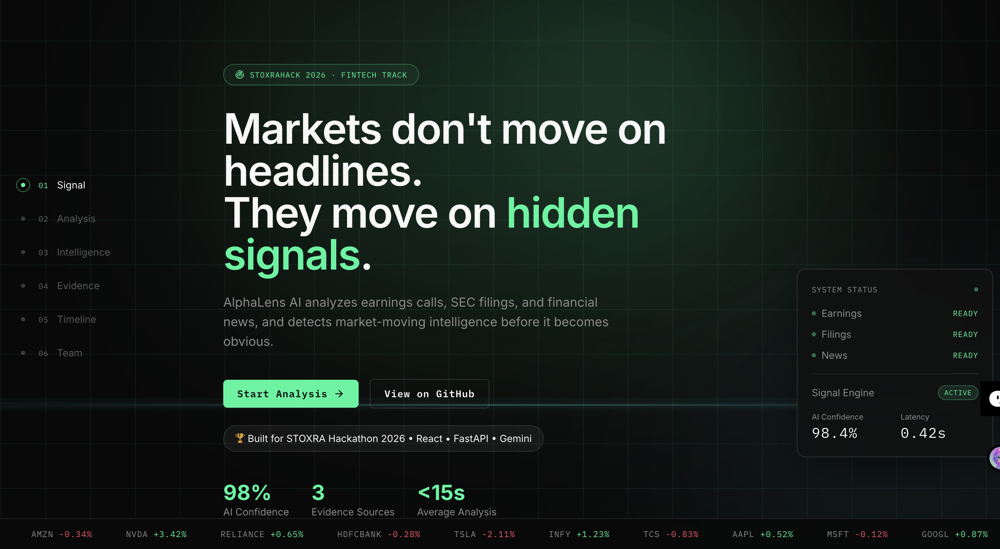

<p align="center">
  
</p>

<h1 align="center">🚀 AlphaLens AI</h1>

<p align="center">
  <strong>AI-Powered Financial Intelligence Platform</strong><br>
  Markets don't move on headlines. They move on hidden signals.
</p>

<p align="center">


</p>

<p align="center">
<a href="https://alpha-lens-ai-eta.vercel.app"><strong>🌐 Live Demo</strong></a>
&nbsp;&nbsp;•&nbsp;&nbsp;
<a href="https://alphalens-backend-t8ky.onrender.com"><strong>⚙️ Backend API</strong></a>
</p>

---

# 📖 Overview

**AlphaLens AI** is an AI-powered financial intelligence platform that transforms **earnings calls**, **SEC filings**, and **financial news** into explainable investment insights.

Instead of summarizing information, AlphaLens detects hidden market signals, assigns confidence scores, highlights supporting evidence, and presents everything through an interactive intelligence dashboard.

Built for **STOXRA Hackathon 2026 – FinTech Track**.

> **Current status:** the full product flow — watchlist → analysis pipeline → intelligence dashboard — runs end to end through the FastAPI backend. Analysis reports are currently generated from curated sample data for each supported company (INFY, TCS, RELIANCE, HDFCBANK, ICICIBANK, NVDA, AAPL, MSFT). The Gemini integration (`backend/app/services/gemini_service.py`) is built and ready to plug into the pipeline — see the [Roadmap](#-roadmap).

---

# ✨ Features

- 📈 AI-powered financial signal detection
- 📰 Multi-source intelligence analysis
- 🧠 Explainable AI insights
- 🎯 Confidence scoring engine
- 📑 Evidence-backed reports
- ⚡ Interactive analysis workflow
- 📊 Intelligence dashboard
- 🌙 Modern responsive UI
- 🚀 FastAPI + React architecture

---

# 🏗️ Architecture

```text
                Earnings Calls
                      │
                SEC Filings
                      │
               Financial News
                      │
                      ▼
              AlphaLens AI Engine
                      │
      ┌───────────────┼───────────────┐
      │               │               │
 Signal Detection  Confidence AI  Evidence Mapping
                      │
                      ▼
          Interactive Intelligence Dashboard
```

---

# 🛠️ Tech Stack

| Category | Technologies |
|-----------|--------------|
| Frontend | React 18, TypeScript, Vite, Tailwind CSS, Framer Motion |
| Backend | FastAPI, Python 3.11, Pydantic |
| AI | Google Gemini (integration module ready; reports currently use curated sample data) |
| Deployment | Vercel, Render |
| Version Control | Git & GitHub |

---

# 📂 Project Structure

```text
AlphaLens-AI
│
├── backend
│   ├── app
│   │   ├── api          # /health and /analyze routes
│   │   ├── services     # transcript, news, analysis, Gemini
│   │   ├── schemas      # Pydantic models
│   │   └── utils        # settings, logging
│   ├── .env.example
│   ├── requirements.txt
│   └── runtime.txt
│
├── frontend
│   ├── src
│   │   ├── pages        # Landing, Analysis, AnalysisProcess, Dashboard
│   │   ├── components   # landing, analysis, dashboard, layout, ui
│   │   └── services     # API client for POST /analyze
│   ├── public
│   ├── .env.example
│   └── package.json
│
├── screenshot
│   └── Hero.png
│
└── README.md
```

---

# 🚀 Getting Started

## Clone Repository

```bash
git clone https://github.com/techAsmita/AlphaLens-AI.git

cd AlphaLens-AI
```

---

> **Requires Python 3.11+ and Node.js 18+.** Run the backend and frontend in two separate terminals.

## Backend Setup

```bash
cd backend

python3.11 -m venv .venv

source .venv/bin/activate      # Windows: .venv\Scripts\activate

pip install -r requirements.txt

cp .env.example .env           # optional — the defaults work out of the box

uvicorn app.main:app --reload
```

Backend runs at

```
http://localhost:8000
```

API docs: `http://localhost:8000/docs` · Health check: `http://localhost:8000/health`

---

## Frontend Setup

```bash
cd frontend

npm install

npm run dev
```

Frontend runs at

```
http://localhost:5173
```

Open the app, click **Start Analysis**, pick a company from the watchlist, and run the analysis to see the intelligence dashboard.

> The backend only accepts requests from `localhost:5173` by default (see `ALLOWED_ORIGINS` in `backend/.env.example`), so use `npm run dev` rather than `npm run preview`, or add the preview port to that list.

---

# 🌐 Deployment

| Service | Platform |
|----------|----------|
| Frontend | Vercel |
| Backend | Render |

Frontend

```
https://alpha-lens-ai-eta.vercel.app
```

Backend

```
https://alphalens-backend-t8ky.onrender.com
```

---

# 🔮 Roadmap

- 🧠 Wire Gemini into the analysis pipeline (replace curated sample signals)
- 📈 Live Market Data
- 🤖 AI Investment Copilot
- 📊 Portfolio Monitoring
- 📑 PDF Intelligence Reports
- 🔍 Multi-company Comparison
- 🔔 Real-time Market Alerts

---

# 👤 Developer

### Asmita Roy

Computer Engineering Student • AI Engineer • Full Stack Developer

- GitHub: https://github.com/techAsmita
- LinkedIn: https://www.linkedin.com/in/techasmita/

---

# ⭐ Support

If you enjoyed this project, consider giving it a ⭐ on GitHub.

It helps the project reach more developers.

---

<p align="center">

Built with ❤️ using React, FastAPI and Google Gemini.

</p>
